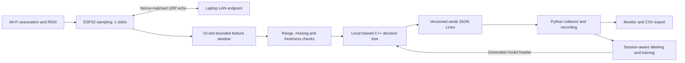

# TinyLink AI — ESP32 Wi-Fi Quality Classification

An embedded C++/TinyML project that measures a local Wi-Fi connection and classifies its current condition as **Stable**, **Degrading**, or **Unstable**. The ESP32 collects RSSI, performs low-rate UDP echo probes to a Windows laptop, extracts a sliding feature window, executes an exported decision tree locally, and emits versioned JSON Lines over USB serial. No cloud inference, sensors, display, GPU, paid service or second board is required.

**Validation status:** firmware cross-build succeeds; **65 automated tests pass**; **9,071 Python/C++ vectors agree**. A deterministic synthetic demonstration runs end to end. **No physical ESP32 was connected or flashed.** The supplied model approximates an explicit current-window quality policy using synthetic data; it is not a validated future-outage predictor. See [actual results and limitations](docs/results.md).

## Architecture



The seven-feature schema lives in [schema/features.json](schema/features.json). Its generated firmware header and the model share a SHA-256 contract checked in Python and at C++ compile time. Portable firmware logic is separated from Arduino networking, enabling host tests without hardware.

## Requirements and installation

- Windows laptop, Python **3.11–3.13** (tested: **3.13.3**), Git, network access for initial dependency installation.
- Optional physical **classic ESP32 DevKit**, data-capable USB cable and a permitted **2.4 GHz** LAN. The laptop and ESP32 must be able to exchange UDP traffic; guest/client isolation can prevent it.
- PlatformIO Core **6.1.18**, Espressif platform **8.0.0**, Arduino-ESP32 **3.3.12**. PlatformIO installs the target compiler automatically. The Windows development lock includes Zig **0.14.1** for native C++ tests; Ubuntu CI uses g++.

From this project directory in PowerShell:

```powershell
cd D:\TinyLink-AI-ESP32
python -m venv .venv
.\.venv\Scripts\python -m pip install -r requirements-lock.txt
.\.venv\Scripts\Activate.ps1
python -m pip check
```

If activation is restricted, replace `python` below with `.\.venv\Scripts\python`; no system policy change is required. On Linux use `source .venv/bin/activate`. Run commands from the checkout root: schema, model and firmware assets are source files, not a standalone installed wheel. `requirements.txt` pins runtime dependencies, `requirements-dev.txt` adds build/tests, and `requirements-lock.txt` pins the complete tested environment. Initial native Zig compilation may take several minutes; later builds are cached by file contents.

## Run the hardware-free demonstration

```powershell
python -m scripts.demo --output-dir build/my-demo
python -m host.monitor --input build/my-demo/session.jsonl
```

The demo generates seed-42 **synthetic** measurements, passes them through the **compiled native C++ firmware inference and telemetry serializer**, validates and records the messages, exports CSV, and renders `session.png`. It deliberately rejects two malformed records and resumes. It asserts every C++ prediction against the Python reference. The monitor always displays provenance and reads predictions already present in telemetry. Live serial display never runs a laptop classifier.

Use a fresh output directory for each demo: recordings and CSV exports deliberately refuse to overwrite existing files. This is host simulation, not ESP32 timing or physical RF data.

## Build and flash firmware

The default build contains no credentials, builds reproducibly and emits `config_error` until configured:

```powershell
python scripts/generate_schema.py --check
python -m platformio run --project-dir firmware -e esp32dev
python -m host.collect --list-ports
Copy-Item firmware/include/secrets.example.h firmware/include/secrets.h
```

Edit the ignored `secrets.h` with your network SSID/password, laptop LAN IPv4 octets from `ipconfig`, and UDP port 3333. Never add it to Git. `esp32dev` is a selected classic-ESP32 target, **not an identified attached board**. Confirm your actual board/chip before upload and choose a matching PlatformIO board if it differs.

Start the endpoint in another terminal, and use your actual USB port in place of the illustrative `COM9`:

```powershell
python -m host.endpoint --bind 0.0.0.0 --port 3333
python -m platformio run --project-dir firmware -e esp32dev --target upload --upload-port COM9
```

The board sends one small UDP probe per second to that laptop, accepts only a matching payload/address/port, and times out at 500 ms. No external ping target is used. Allow Python's UDP endpoint on the trusted private Windows network if prompted; keep the laptop awake. Endpoint CPU/Wi-Fi scheduling contributes to RTT. A failed probe indicates failure to reach **that endpoint**, not whole-network packet loss.

## Collect, visualize and export

```powershell
python -m host.collect --port COM9 --duration 300 --output data/sessions/normal-01.jsonl
python -m host.monitor --port COM9 --save-session data/sessions/live-01.jsonl
python -m host.export --input data/sessions/normal-01.jsonl --output data/sessions/normal-01.csv
python -m host.monitor --input data/sessions/normal-01.jsonl --output build/normal-01.png
python -m host.benchmark --input data/sessions/normal-01.jsonl
```

Run either the collector or live monitor against a port at a time. Omit `--duration` to collect until Ctrl+C. The collector can auto-select exactly one USB serial candidate; otherwise specify `--port`. It retries serial failures up to five times, saves complete records on shutdown, records UTC host timestamps and session IDs, and writes accepted/rejected/gap/reset counters to a neighboring `.stats.json` file. A board reset starts a new recording session. The timing summarizer excludes simulation/replay data.

The plotting monitor shows RSSI, mean latency, current prediction/state, and disconnect/reconnect or quality state transitions. Live display buffers are bounded; the complete session is written to disk. Malformed messages are counted and skipped. A small parser-only replay is available after setup:

```powershell
python -m host.collect --input data/fixtures/synthetic.jsonl --output build/fixture-replay.jsonl
python -m host.export --input build/fixture-replay.jsonl --output build/fixture-replay.csv
```

## Train, evaluate and reproduce the model

The [labeling policy](docs/labeling.md) is defined independently of training. It uses declared demonstration service objectives for the **current ten-slot window**:

- **Unstable:** failure fraction >=0.4, at least two disconnects, or last success >=5 seconds ago.
- **Degrading:** otherwise failure fraction >=0.1, at least one disconnect, RSSI <-75 dBm, mean RTT >=80 ms, or RTT standard deviation >=30 ms.
- **Stable:** otherwise.

This makes the exact labeling policy an oracle baseline. A learned tree is an approximation and offers no predictive advantage over that oracle. A training-set majority baseline is also evaluated. The model is learned with sklearn, not a hand-written rule substitution disguised as training.

```powershell
python -m ml.synthetic --output data/generated/training.jsonl
python -m ml.train --data data/generated/training.jsonl
python -m pytest -ra
python -m platformio run --project-dir firmware
```

The deterministic default creates 18 sessions and 3078 complete windows. Training uses sessions 0–11, model selection uses 12–14, and testing uses 15–17 (513 windows). Candidates have maximum depth 2–8, at least five samples per leaf; select the smallest tree within 0.01 of the best validation macro-F1. Entire sessions stay together, preventing leakage from adjacent overlapping windows. JSON export is checked against sklearn. The C++ model uses identical float32 preprocessing and exact split thresholds.

Artifacts: [tree.json](ml/artifacts/tree.json), [evaluation.json](ml/artifacts/evaluation.json), and [model_generated.h](firmware/include/model_generated.h). Reports include per-class precision/recall/F1, confusion matrices, source and session breakdowns, oracle/majority baselines, and an independent-feature stress set. No real-session performance is claimed. The smaller stress-set score shows that high in-distribution synthetic accuracy does not guarantee arbitrary-condition correctness.

For real recordings, collect >=6 independent sessions and concatenate whole files in acquisition order, preserving IDs. Keep synthetic/real provenance intact. Train a candidate separately before replacing firmware assets:

```powershell
python -m ml.train --data data/sessions/combined.jsonl --output build/real-candidate --header build/real-candidate/model_generated.h
```

To change the schema, edit its JSON, run `python scripts/generate_schema.py`, regenerate compatible data and retrain. Schema/header/model drift is rejected. Do not randomly split adjacent windows or claim future prediction from current-policy labels.

## Verification and measured results

```powershell
python -m scripts.verify --firmware
```

This saves actual test/build logs and `build/verification.json`. Checks include schema validation, labels, dataset loading, session splits, deterministic training, metrics, safe JSON model loading, portable C++ features/state/configuration/serialization, Python/C++ equivalence, serial fragmentation/noise/oversize/recovery, collector/export, plotting, and actual host UDP echo sockets. [CI](.github/workflows/ci.yml) defines Windows/Ubuntu software checks plus a hardware-free Ubuntu ESP32 cross-build; **hosted CI has not run** because the project has no published remote.

Measured on 27 October 2026:

| Result | Actual value and scope |
| --- | --- |
| Automated tests | **65 passed, 0 failed** on Windows/Python 3.13.3 |
| Python/native C++ equivalence | **9071/9071** matching predictions |
| Model | **25 nodes, depth 5**, model ID `ab8dbd39bad830ec` |
| Held-out synthetic accuracy / macro-F1 | **99.61% / 0.9929**, 513 windows |
| Majority / exact policy baseline accuracy | **51.07% / 100%** on those synthetic test windows |
| Independent-feature stress accuracy / macro-F1 | **85.42% / 0.6762**, 960 artificial combinations |
| Credential-free firmware flash usage | **945720 / 1310720 bytes** (72.2% application partition) |
| Static RAM reported by build | **49864 / 327680 bytes** (15.2%; excludes runtime heap/stack usage) |
| Firmware `.bin` file | **956976 bytes** (different accounting from linked flash usage) |
| Model JSON / generated C++ header | **2569 / 1882 bytes** of source/artifact text, not machine-code size |
| Actual ESP32 inference/extraction/recovery timing | **Pending physical hardware** |

## Repository layout

```text
firmware/           Arduino adapter, portable C++ core and generated contracts
host/               Serial collector, UDP endpoint, monitor, CSV and timing tools
ml/                 Synthetic sessions, labeling policy, training/export/evaluation
schema/             Authoritative feature definition
scripts/            Schema generation, native build, demo and verification
tests/              Python integration tests and portable firmware assertions
data/fixtures/      Small explicit synthetic and malformed telemetry fixtures
docs/               Contract, environment audit, results and physical validation
.github/workflows/  Software checks and ESP32 cross-build
```

## Troubleshooting and limits

- **Only Bluetooth COM ports:** connect a board with a data cable; identify the USB bridge/driver. No USB ESP32 was present during this build. Do not flash a guessed Bluetooth port.
- **`config_error`:** create the ignored secrets header and rebuild/upload. Empty SSID, short nonempty password, invalid IPv4 or port are rejected without printing secrets. Open networks can use an empty password.
- **Warmup/stale window:** wait ten slots. A scheduling pause or invalid measurement suppresses inference until a complete fresh window returns. The application continues association retries and serial telemetry throughout outages.
- **Connected but many failed probes:** verify the endpoint is running, laptop IPv4/port, private firewall access, and AP client isolation. Endpoint failure can produce an Unstable quality prediction with an otherwise associated Wi-Fi station.
- **Upload/serial access denied:** close other monitors, confirm the USB port and BOOT procedure. Use a fresh recording path to avoid overwriting evidence.
- **PlatformIO version notice:** the pinned 6.1.18 core can report that a newer 6.2.0 core has been used elsewhere on this laptop. The pinned path built successfully; do not change unrelated projects' toolchains to silence a notice.
- **Missing native compiler:** install the development lock on Windows (includes Zig); on Linux install g++. First-run Zig system-library compilation is slower than subsequent builds.
- **Model limitations:** synthetic policy approximation, no real training/validation, no throughput/PHY interference measurement, AP/endpoint/laptop effects are conflated, and stress accuracy is lower. Ten-slot smoothing adds response lag. This is a student engineering demonstrator, not a safety-critical network controller.

Follow [physical validation](docs/hardware-validation.md) before publishing device-performance claims. [Environment audit](docs/environment.md) records what was found. [Publication preparation](docs/github.md) contains the repository description/topics; no public repository, demo URL or CI badge is invented.

Primary API references: [PlatformIO ESP32 platform](https://docs.platformio.org/en/latest/platforms/espressif32.html), [ESP32 Dev Module target](https://docs.platformio.org/en/latest/boards/espressif32/esp32dev.html), [Espressif Wi-Fi API](https://docs.espressif.com/projects/arduino-esp32/en/latest/api/wifi.html). Exact API availability was also verified against the installed pinned Arduino framework and a successful cross-build.
